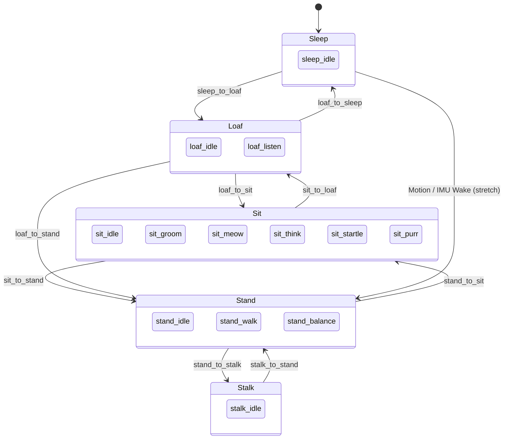

# Sagwa Firmware Architecture

This document provides a comprehensive technical overview of the software architecture powering the **Sagwa** feline companion on the **M5Stack CoreS3** (ESP32-S3).

---

## System Architecture

```mermaid
flowchart TD
    subgraph Hardware ["Hardware Layer (M5Stack CoreS3)"]
        ESP32S3["ESP32-S3 SoC (240MHz, 512KB SRAM, 8MB PSRAM, 16MB Flash)"]
        LCD["ILI9342C IPS LCD (320x240, SPI DMA)"]
        TOUCH["FT6336U Capacitive Touch (I2C)"]
        AUDIO["AW88298 I2S Amp + Speaker / SPM1423 PDM Mic"]
        SENSORS["LTR-553ALS-WA (ALS/Prox) & BMI270 (6-Axis IMU)"]
    end

    subgraph OS ["FreeRTOS & ESP-IDF v6.0.1 Drivers"]
        SPIDMA["SPI DMA Driver"]
        I2C["I2C Master Bus (I2C0 @ 400kHz)"]
        I2S["I2S Audio Pipeline (16kHz 16-bit Mono)"]
        ROMJPG["ESP32-S3 ROM TJpgDec Hardware Decoder"]
        WIFI_BLE["Wi-Fi 802.11 b/g/n & BLE 5.0 Stack"]
    end

    subgraph CoreEngine ["Sagwa Core Runtime"]
        ANIM["Animation Subsystem (sagwa_clips.c)\nClip Graph FSM & Idle Scheduler"]
        SFX["Feline Sound Engine (sagwa_sfx.c)\n16kHz PCM Mixer (Purrs, Meows, Trills)"]
        NOTIFY["Message Classifier (sagwa_notify.c)\nChat / Notify / Urgent"]
        UPDATE["Self-Update (sagwa_update.c)\nGitHub Releases + OTA"]
        SENS["Sensor Task (cores3_sensors.c)\nProx Petting, Auto-Brightness, Motion Wake"]
        STATS["Activity Statistics (sagwa_stats.c)\nNVS Persistence (Wakes, Meows, Purrs)"]
    end

    subgraph UI ["User Interface & Networking"]
        LVGL["LVGL Graphics Engine\nAvatar Display & Scrollable Chat Reply Panel"]
        THUMBS["Image Thumbnail Pipeline (muse_thumbs.c)\nROM Inflate / TJpgDec (96px Previews)"]
        LINK["Muse Home Link & Noise Protocol\nEncrypted Session to LLM / Agent Backend"]
    end

    Hardware --> OS
    OS --> CoreEngine
    CoreEngine --> UI
```



---

## Flash Partition Geometry (16 MB SPI Flash)

The firmware utilizes a custom 16 MB partition layout defined in `partitions_muse_cores3.csv`:

| Partition | Type | SubType | Flash Offset | Size | Purpose |
|---|---|---|---|---|---|
| `bootloader` | `bootloader` | - | `0x000000` | ~21 KB | ESP-IDF 2nd stage bootloader |
| `partition-table` | `table` | - | `0x010000` | 3 KB | Custom partition table |
| `nvs` | `data` | `nvs` | `0x011000` | 48 KB (`0xC000`) | Wi-Fi credentials, BLE bonds, Sagwa stats |
| `otadata` | `data` | `ota` | `0x01D000` | 8 KB (`0x2000`) | OTA slot selection state |
| `phy_init` | `data` | `phy` | `0x01F000` | 4 KB (`0x1000`) | RF calibration parameters |
| `ota_0` | `app` | `ota_0` | `0x020000` | 4 MB (`0x400000`)| Primary application firmware image |
| `ota_1` | `app` | `ota_1` | `0x420000` | 4 MB (`0x400000`)| Secondary OTA update slot |
| `prod_data` | `data` | `0x40` | `0x820000` | 4 KB (`0x1000`) | Factory production metadata |
| `prod_bak` | `data` | `0x41` | `0x821000` | 4 KB (`0x1000`) | Production backup data |
| **`sagwa`** | `data` | `0x50` | **`0x830000`** | **7.81 MB (`0x7D0000`)** | **`sagwa_clips.bin` 22-clip animation pack** |

---

## Animation Engine (`sagwa_clips.c`)

### 1. Hub Poses & Clip Graph Topology
The animation system is modeled as a directed graph over six canonical **Hub Poses**:
- **0: Sleep** (`sleep.png`)
- **1: Loaf** (`wake.png`)
- **2: Sit** (`listen.png`)
- **3: Stand** (`idle.png`)
- **4: Stalk** (`work.png`)
- **5: Stretch** (dynamic transitional pose)



Every transition clip starts on the exact drawing of the source hub and ends on the exact drawing of the target hub. This eliminates the need for expensive alpha cross-dissolves on microcontrollers while providing buttery-smooth motion.

### 2. Binary Pack Format (`SGWC`)
Packed via `sagwa/tools/pack_clips.py`:

```
Header (Little Endian, 24 bytes):
  char magic[4]       = "SGWC"
  uint16_t version    = 1
  uint16_t width      = 240
  uint16_t height     = 208
  uint16_t fps        = 12
  uint16_t clips      = 22
  uint16_t reserved   = 0
  uint32_t total_frames
  uint32_t frame_table_offset
  uint32_t data_offset

Clip Table (22 entries × 28 bytes):
  char name[20]       (e.g., "sit_meow")
  uint16_t first_frame_idx
  uint16_t frame_count
  uint8_t  from_hub
  uint8_t  to_hub
  uint8_t  flags      (Bit 0: loopable on hub)
  uint8_t  pad

Frame Table (total_frames × 8 bytes):
  uint32_t offset_from_data
  uint32_t jpeg_size

Data:
  Raw baseline JPEG frames (240×208 pixels)
```

### 3. Hardware JPEG Decoding (Core 0 Task)
- Frames are decoded directly from flash memory using the ESP32-S3 ROM's `TJpgDec` decoder running on Core 0.
- Decoded 16-bit RGB565 scanlines are streamed into LVGL display buffers without intermediary full-frame DRAM buffering, keeping RAM consumption under 60 KB.

---

## Feline Sound Engine (`sagwa_sfx.c`)

- **Format**: 16 kHz, 16-bit mono PCM, mixed in 20 ms chunks (320 samples) in `sagwa_sfx_step()` alongside the voice pipeline in `muse_voice.c`.
- **Sound bank** (`sagwa_sfx_data.h`, generated by `sagwa/tools/make_sfx.py` from real cat recordings in `sagwa/sounds/`, see [ATTRIBUTION.md](ATTRIBUTION.md)). Every kind has several takes; one is picked at random (never the same twice running) and played up to 4% higher or lower, so each kind is recognisable without being the exact same clip:

| Sound | Takes | Used for |
|---|---|---|
| `SAGWA_SFX_URGENT` | 3 | Loud insistent double meow: an important message. Repeats twice more, 20 s apart, until she is touched, a hand comes near, or the button is pressed |
| `SAGWA_SFX_NOTIFY` | 3 | Short bright chirp: an ordinary new message; also before she updates herself |
| `SAGWA_SFX_CHAT` | 3 | Soft low mrrow: a reply while you are talking with her |
| `SAGWA_SFX_TRILL_LISTEN` | 1 | Rising trill when a voice note has gone |
| `SAGWA_SFX_MURMUR_ACTIVITY` | 2 | Throat mrrp while thinking, or calling out on her own |
| `SAGWA_SFX_YAWN` | 1 | Lying down to sleep, stretching |
| `SAGWA_SFX_STARTLE` | 2 | Startled mew or little hiss; a failed update |
| `SAGWA_SFX_HUNT_CHATTER` | 1 | "ek-ek-ek" while stalking |
| `SAGWA_SFX_HAPPY_TRILL` | 2 | Start-up hello; an update that went well |
| Purr loop | 1 | Continuous while petted (touch or the proximity sensor), ducked under any meow |

- **Choosing the sound for a message** (`sagwa_notify.c`, pure C, tested on the host by `tests/test_sagwa_notify.py`). The sound waits up to 1.5 s for the message's text, then:
  1. **Chat**: a reply to your own voice note, or a message within 10 minutes of your last exchange (or within 3 minutes of the previous incoming message: a conversation going on).
  2. **Urgent**: "urgente", "emergencia", "alarma", "urgent", "emergency"... even mid-conversation; outside a conversation also "importante", "recordatorio", "alerta", "atencion", "error", "fallo", "reminder", "warning", "failed", "asap", "!!", or mostly upper-case text.
  3. **Notify**: everything else.
- **Body language** (`sagwa_clips_cue`): urgent messages startle her up to stand at attention; a notification pricks her ears (awake from sleep, listening); a chat has her sit with you to talk.
- **Quiet hours**: her own idle sounds stop at night or in a dark room; messages still sound.

---

## Behaviour (`sagwa_clips.c`)

What Sagwa does on her own comes from four moods, updated every frame:

- **Energy** drains while awake (faster when warm or sleepy) and refills asleep.
- **Sleepiness** follows the local time (SNTP, time zone `CONFIG_SAGWA_TZ`: night, evening, siesta) and the room light from the LTR-553 (dark below 5 lux).
- **Boredom** grows when nothing happens; play, petting and conversation use it up.
- **Contentment** rises with petting and conversation and fades over ~15 minutes.

Each idle decision weighs where to go from her hub by those moods and is less keen on hubs she has just visited (no pacing back and forth). Dwell times scale with them too: long stretches of sleep at night, short sits when bored, longer loafs when content. Bored, rested cats play in bouts of 1-3 pounces. Grooming is likelier after petting or waking; calling out happens only when she is bored and someone is around. Walking depends on energy and boredom, and at the screen edge she sits to turn round.

The sensors are her senses: being moved gets her up (a hard jolt startles her first); lights going on after a dark spell wake her and, if rested, she stretches; lights out sends her to bed soon; a hand appearing fast makes her jump (`sit_startle`); a desk tilted more than 20 degrees from where it usually rests has her balancing (`stand_balance`).

---

## Self-Update from GitHub (`main/sagwa_update.c`)

1. Every push to `main` runs `.github/workflows/release.yml`: it builds the CoreS3 firmware with version `1.0.<run number>`, signs it, and publishes a release with `sagwa-cores3.bin`, `sagwa_clips.bin` and `manifest.json` (`version`, SHA-256 and size of both binaries, the commit message as notes). The binaries are also committed to `bin/`.
2. Sagwa fetches `releases/latest/download/manifest.json` 2 minutes after Wi-Fi comes up and then every `CONFIG_SAGWA_UPDATE_INTERVAL_MIN` (180) minutes, give or take 15.
3. If the version is newer than hers, or the clip pack's SHA-256 differs from the one in her `sagwa` partition, she waits until nobody has talked with her or touched her for 2 minutes (and the battery is above 30% if she is on it).
4. She chirps and says on screen that a new version is out, with the notes, and counts down 30 s. Touching her puts it off for 10 minutes.
5. Clips: the player stops, the pack is streamed into the partition and checked against the manifest's SHA-256. Firmware: `ota.c` downloads it into the other OTA slot and checks its signature. Then she restarts.
6. On the next boot she trills and says "Ya me actualice! vX -> vY" (or that it failed, if the bootloader rolled the image back). The image is kept once it has reached GitHub again (or the Muse control connection), else the bootloader reverts it after 5 minutes.

Set `CONFIG_SAGWA_AUTO_UPDATE=n` to turn this off. **Settings > Sagwa > Check for updates** wakes the updater to check at once and, if there's a newer release, install it straight away (no quiet-moment wait or countdown). With a microSD card, a new clip pack is downloaded and SHA-checked on the card first, while she keeps playing, and only then copied into the partition; the staged files are deleted once the boot after the update reports success (and at any boot with no update pending).

---

## Offline (`sagwa_offline.c`, `sagwa_store.c`, `cores3_rtc.c`)

- **Storage**: the microSD (FAT32) is mounted at `/sdcard` on the display's SPI bus; Sagwa uses `/sdcard/sagwa/cache/` and `/sdcard/sagwa/update/`. Writes go through a temporary file and a rename. Without a card everything falls back to RAM and NVS.
- **Clock**: SNTP sets it online; each sync is written to the BM8563 RTC (I2C 0x51, UTC), which sets the clock at the next boot, internet or not.
- **Weather**: every hour online, the update task finds the rough location by IP (ip-api.com, remembered in NVS) and fetches current conditions and a 3-day forecast from Open-Meteo (no key). It's kept in RAM and on the card. The response's UTC offset becomes the time zone unless `CONFIG_SAGWA_TZ` is set.
- **The card**: a double tap on Sagwa, or a press to talk when there's no Wi-Fi and nothing can be recorded, shows the time and date, the device's temperature and light, and the weather (with its age) in her bubble for 12 s.

---

## Sensor Integration (`cores3_sensors.c`)

The sensor subsystem runs as a dedicated FreeRTOS task on Core 1:

1. **LTR-553ALS-WA**:
   - Registers read at 10 Hz over I2C0 (`0x23`).
   - ALS Channel 0 and Channel 1 combined using lux transfer equations:
     $$\text{lux} = f(\text{CH0}, \text{CH1})$$
   - Proximity data compared against petting threshold ($\ge 180$ counts).
2. **BMI270 6-Axis IMU**:
   - Configured with microcode blob at startup (`0x69`).
   - 100 Hz Accelerometer ($\pm 8g$) + 200 Hz Gyroscope ($\pm 2000^\circ/\text{s}$).
   - Computes continuous spatial tilt angle and rotation magnitude.
3. **RPC Telemetry**:
   - Responds to `sensors.read` JSON-RPC query:
     ```json
     {
       "illuminance": {"value": 142.5, "unit": "lux", "age_s": 0.05},
       "proximity": {"value": 0, "unit": "counts", "age_s": 0.05},
       "tilt_angle": {"value": 3.2, "unit": "degrees", "age_s": 0.05},
       "temperature": {"value": 32.1, "unit": "celsius", "age_s": 0.05}
     }
     ```

---

## Activity Tracking & Stats (`sagwa_stats.c`)

Tracks Sagwa's daily activities in Non-Volatile Storage (NVS):
- Daily wakeup count (motion + touch)
- Total purring time (seconds)
- Meows emitted
- Total device uptime
- Exposed in the LVGL settings screen under `>ui=sagwa`.
