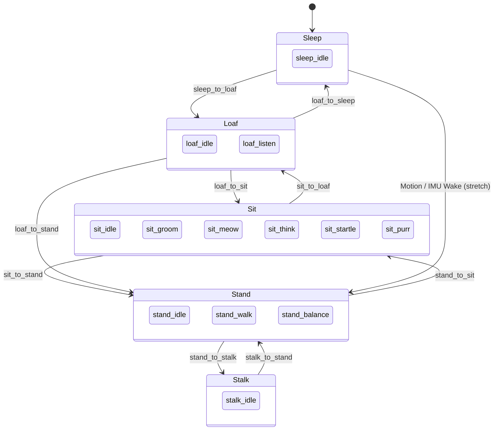

# Sagwa Firmware Architecture

This document provides a comprehensive technical overview of the software architecture powering the **Sagwa** feline companion on the **M5Stack CoreS3** (ESP32-S3).

---

## System Architecture

```mermaid
flowchart TD
    subgraph Hardware ["Hardware Layer (M5Stack CoreS3)"]
        ESP32S3["ESP32-S3 SoC (240MHz, 512KB SRAM, 8MB PSRAM, 16MB Flash)"]
        LCD["ILI9342C IPS LCD (320x240, SPI DMA)"]
        TOUCH["FT6336U Capacitive Touch (I2C)"]
        AUDIO["AW88298 I2S Amp + Speaker / SPM1423 PDM Mic"]
        SENSORS["LTR-553ALS-WA (ALS/Prox) & BMI270 (6-Axis IMU)"]
    end

    subgraph OS ["FreeRTOS & ESP-IDF v6.0.1 Drivers"]
        SPIDMA["SPI DMA Driver"]
        I2C["I2C Master Bus (I2C0 @ 400kHz)"]
        I2S["I2S Audio Pipeline (16kHz 16-bit Mono)"]
        ROMJPG["ESP32-S3 ROM TJpgDec Hardware Decoder"]
        WIFI_BLE["Wi-Fi 802.11 b/g/n & BLE 5.0 Stack"]
    end

    subgraph CoreEngine ["Sagwa Core Runtime"]
        ANIM["Animation Subsystem (sagwa_clips.c)\nClip Graph FSM & Idle Scheduler"]
        SFX["Feline Sound Engine (sagwa_sfx.c)\n16kHz PCM Mixer (Purrs, Meows, Trills)"]
        SENS["Sensor Task (cores3_sensors.c)\nProx Petting, Auto-Brightness, Motion Wake"]
        STATS["Activity Statistics (sagwa_stats.c)\nNVS Persistence (Wakes, Meows, Purrs)"]
    end

    subgraph UI ["User Interface & Networking"]
        LVGL["LVGL Graphics Engine\nAvatar Display & Scrollable Chat Reply Panel"]
        THUMBS["Image Thumbnail Pipeline (muse_thumbs.c)\nROM Inflate / TJpgDec (96px Previews)"]
        LINK["Muse Home Link & Noise Protocol\nEncrypted Session to LLM / Agent Backend"]
    end

    Hardware --> OS
    OS --> CoreEngine
    CoreEngine --> UI
```



---

## Flash Partition Geometry (16 MB SPI Flash)

The firmware utilizes a custom 16 MB partition layout defined in `partitions_muse_cores3.csv`:

| Partition | Type | SubType | Flash Offset | Size | Purpose |
|---|---|---|---|---|---|
| `bootloader` | `bootloader` | - | `0x000000` | ~21 KB | ESP-IDF 2nd stage bootloader |
| `partition-table` | `table` | - | `0x010000` | 3 KB | Custom partition table |
| `nvs` | `data` | `nvs` | `0x011000` | 48 KB (`0xC000`) | Wi-Fi credentials, BLE bonds, Sagwa stats |
| `otadata` | `data` | `ota` | `0x01D000` | 8 KB (`0x2000`) | OTA slot selection state |
| `phy_init` | `data` | `phy` | `0x01F000` | 4 KB (`0x1000`) | RF calibration parameters |
| `ota_0` | `app` | `ota_0` | `0x020000` | 4 MB (`0x400000`)| Primary application firmware image |
| `ota_1` | `app` | `ota_1` | `0x420000` | 4 MB (`0x400000`)| Secondary OTA update slot |
| `prod_data` | `data` | `0x40` | `0x820000` | 4 KB (`0x1000`) | Factory production metadata |
| `prod_bak` | `data` | `0x41` | `0x821000` | 4 KB (`0x1000`) | Production backup data |
| **`sagwa`** | `data` | `0x50` | **`0x830000`** | **7.81 MB (`0x7D0000`)** | **`sagwa_clips.bin` 22-clip animation pack** |

---

## Animation Engine (`sagwa_clips.c`)

### 1. Hub Poses & Clip Graph Topology
The animation system is modeled as a directed graph over six canonical **Hub Poses**:
- **0: Sleep** (`sleep.png`)
- **1: Loaf** (`wake.png`)
- **2: Sit** (`listen.png`)
- **3: Stand** (`idle.png`)
- **4: Stalk** (`work.png`)
- **5: Stretch** (dynamic transitional pose)



Every transition clip starts on the exact drawing of the source hub and ends on the exact drawing of the target hub. This eliminates the need for expensive alpha cross-dissolves on microcontrollers while providing buttery-smooth motion.

### 2. Binary Pack Format (`SGWC`)
Packed via `sagwa/tools/pack_clips.py`:

```
Header (Little Endian, 24 bytes):
  char magic[4]       = "SGWC"
  uint16_t version    = 1
  uint16_t width      = 240
  uint16_t height     = 208
  uint16_t fps        = 12
  uint16_t clips      = 22
  uint16_t reserved   = 0
  uint32_t total_frames
  uint32_t frame_table_offset
  uint32_t data_offset

Clip Table (22 entries × 28 bytes):
  char name[20]       (e.g., "sit_meow")
  uint16_t first_frame_idx
  uint16_t frame_count
  uint8_t  from_hub
  uint8_t  to_hub
  uint8_t  flags      (Bit 0: loopable on hub)
  uint8_t  pad

Frame Table (total_frames × 8 bytes):
  uint32_t offset_from_data
  uint32_t jpeg_size

Data:
  Raw baseline JPEG frames (240×208 pixels)
```

### 3. Hardware JPEG Decoding (Core 0 Task)
- Frames are decoded directly from flash memory using the ESP32-S3 ROM's `TJpgDec` decoder running on Core 0.
- Decoded 16-bit RGB565 scanlines are streamed into LVGL display buffers without intermediary full-frame DRAM buffering, keeping RAM consumption under 60 KB.

---

## Feline Sound Engine (`sagwa_sfx.c`)

- **Format**: 16 kHz, 16-bit mono PCM.
- **Buffer Processing**: Processes audio in 20 ms chunks (320 samples per frame) directly in `sagwa_sfx_step()`.
- **Mixing Pipeline**: Interleaved with the primary voice/TTS audio pipeline in `muse_voice.c`.
- **Natural SFX Bank**:
  - `meow.pcm`: 0.8s feline greeting vocalization.
  - `purr.pcm`: Continuous rhythmic 1.2s purr loop.
  - Trills, soft chirps, and startled vocalizations.
- **Interactive Triggers**:
  - `sagwa_sfx_pet_pulse()`: Triggered by hand proximity sensor to start rhythmic purring.
  - `sagwa_sfx_on_rig_change()`: Triggered on state machine hub transitions.

---

## Sensor Integration (`cores3_sensors.c`)

The sensor subsystem runs as a dedicated FreeRTOS task on Core 1:

1. **LTR-553ALS-WA**:
   - Registers read at 10 Hz over I2C0 (`0x23`).
   - ALS Channel 0 and Channel 1 combined using lux transfer equations:
     $$\text{lux} = f(\text{CH0}, \text{CH1})$$
   - Proximity data compared against petting threshold ($\ge 180$ counts).
2. **BMI270 6-Axis IMU**:
   - Configured with microcode blob at startup (`0x69`).
   - 100 Hz Accelerometer ($\pm 8g$) + 200 Hz Gyroscope ($\pm 2000^\circ/\text{s}$).
   - Computes continuous spatial tilt angle and rotation magnitude.
3. **RPC Telemetry**:
   - Responds to `sensors.read` JSON-RPC query:
     ```json
     {
       "illuminance": {"value": 142.5, "unit": "lux", "age_s": 0.05},
       "proximity": {"value": 0, "unit": "counts", "age_s": 0.05},
       "tilt_angle": {"value": 3.2, "unit": "degrees", "age_s": 0.05},
       "temperature": {"value": 32.1, "unit": "celsius", "age_s": 0.05}
     }
     ```

---

## Activity Tracking & Stats (`sagwa_stats.c`)

Tracks Sagwa's daily activities in Non-Volatile Storage (NVS):
- Daily wakeup count (motion + touch)
- Total purring time (seconds)
- Meows emitted
- Total device uptime
- Exposed in the LVGL settings screen under `>ui=sagwa`.
