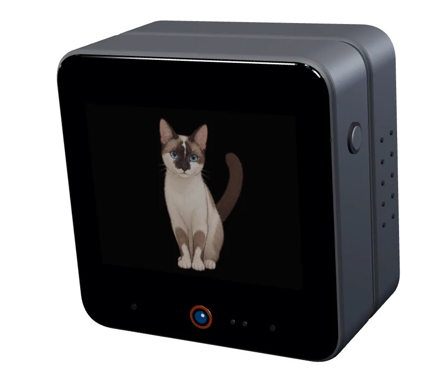
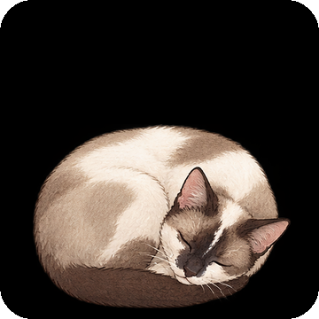
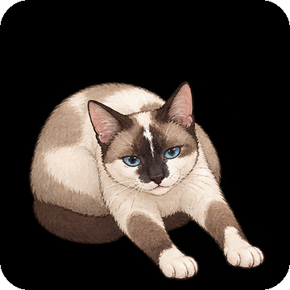
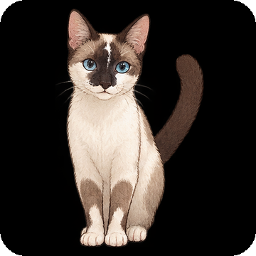
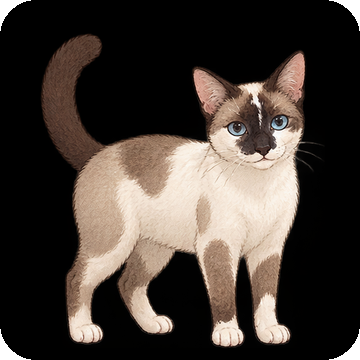
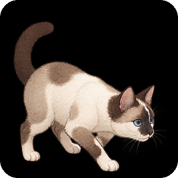

<div align="center">



# Sagwa

**A Siamese cat who lives inside your M5Stack CoreS3.**

She naps when the room goes dark, stretches when you come back, purrs when you pet her
and meows a different meow for every kind of message.

[](https://github.com/terrerovgh/sagwa/releases/latest)
[](https://github.com/terrerovgh/sagwa/actions/workflows/release.yml)
[](https://docs.m5stack.com/en/core/CoreS3)
[](https://docs.espressif.com/projects/esp-idf/en/v6.0.1/)
[](LICENSE)

[**Download**](https://github.com/terrerovgh/sagwa/releases/latest) &nbsp;·&nbsp;
[Install in a minute](#install-in-a-minute) &nbsp;·&nbsp;
[What she does](#what-she-does) &nbsp;·&nbsp;
[How she works](#how-she-works) &nbsp;·&nbsp;
[Build from source](#build-from-source)

</div>

---

## Meet Sagwa

Sagwa is not a screensaver. She is a small, opinionated cat with moods of her own, drawn in
22 hand-directed animation clips and voiced by real cat recordings. She runs entirely on the
CoreS3's ESP32-S3: no app, no cloud account, no subscription. Plug the board in, flash it once,
and from then on she keeps herself up to date.

<table>
<tr>
<td width="33%" valign="top">

### Alive, not looping
22 clips chain through five resting poses with no cross-fades, so every move flows into the
next. Energy, sleepiness, boredom and contentment decide what she does and when.

</td>
<td width="33%" valign="top">

### Speaks cat
Meows, trills, chirps, yawns, hunting chatter and a continuous purr, cut from real recordings.
Each sound has several takes with a touch of random pitch, so she never sounds the same twice.

</td>
<td width="33%" valign="top">

### Notices you
The CoreS3's proximity, light and motion sensors are her senses. Hold a hand near her and she
purrs; turn on the lights and she wakes; tilt the desk and she keeps her balance.

</td>
</tr>
<tr>
<td width="33%" valign="top">

### Reads your messages
A soft *mrrow* while you chat with her, a bright chirp for an ordinary notification, and an
insistent double meow for anything urgent, repeated until you look.

</td>
<td width="33%" valign="top">

### Works offline
Tap her twice for the time, the date, the room's temperature and light, and the last weather
she saw. The clock survives restarts on the board's battery-backed RTC.

</td>
<td width="33%" valign="top">

### Updates herself
Every release is built and signed by GitHub Actions. She checks for it on her own, asks before
installing (touch her to wait) and tells you when she is done.

</td>
</tr>
</table>

---

## What she does

<div align="center">
<table>
<tr>
<td align="center"><br><sub><b>Sleep</b></sub></td>
<td align="center"><br><sub><b>Loaf</b></sub></td>
<td align="center"><br><sub><b>Sit</b></sub></td>
<td align="center"><br><sub><b>Stand</b></sub></td>
<td align="center"><br><sub><b>Stalk</b></sub></td>
</tr>
</table>
<sub>Her five resting poses. Every clip starts and ends on one of them.</sub>
</div>

<br>

| You... | Sagwa... |
| --- | --- |
| hold your hand near the screen | wakes, looks happy and purrs |
| move your hand in fast | jumps (`sit_startle`) |
| pick her up or bump the desk | gets up; a hard jolt startles her first |
| tilt the desk more than 20° | balances on her feet (`stand_balance`) |
| turn the lights on after dark | wakes and, if rested, stretches |
| turn the lights off | heads to bed soon after |
| leave her alone for a while | grooms, naps, walks, plays in short bouts, calls out when bored |
| send her a message | announces it with the meow its urgency deserves |
| tap her twice | shows the time, date, sensors and weather |

She also keeps a diary: wake-ups, minutes purred, meows and uptime per day, stored in flash and
shown in **Settings > Sagwa**.

---

## Install in a minute

You need an **[M5Stack CoreS3](https://docs.m5stack.com/en/core/CoreS3)**, a USB-C **data** cable
and Python 3.8+ with `esptool` (`pip install esptool`).

```bash
git clone https://github.com/terrerovgh/sagwa.git
cd sagwa
./flash.sh            # or: python3 flash.py   (Windows)
```

The flasher finds the board, downloads the [latest release](https://github.com/terrerovgh/sagwa/releases/latest),
writes all five images and reboots. Sagwa wakes up on screen a few seconds later.

<details>
<summary><b>What gets flashed</b></summary>

<br>

| Offset | File | Contents |
| --- | --- | --- |
| `0x000000` | `bootloader.bin` | ESP32-S3 second-stage bootloader |
| `0x010000` | `partition-table.bin` | 16 MB partition layout |
| `0x01D000` | `ota_data_initial.bin` | OTA slot selection |
| `0x020000` | `sagwa-cores3.bin` | Sagwa's firmware (signed) |
| `0x830000` | `sagwa_clips.bin` | The 22-clip animation pack (7.8 MB) |

`flash.py --release v1.0.5` installs a specific version, `--app-only` / `--clips-only` write one
image, and `--bin-dir DIR` flashes your own build. Manual `esptool` commands and
troubleshooting are in [INSTALL.md](INSTALL.md).

</details>

**Optional:** a FAT32 microSD card gives her room for caches and for staging updates while she keeps playing.

---

## Always up to date

1. A push to `main` builds, signs and publishes a release (`v1.0.<run>`) with GitHub Actions.
2. Every few hours (3 h by default) Sagwa checks for it. When nobody is talking to her, she
   chirps and shows *"Hay una version nueva de mi..."* with a 30-second countdown. Touch her to
   put it off for 10 minutes.
3. She downloads and verifies the update, restarts, and greets you with a happy trill:
   *"Ya me actualice! v1.0.4 -> v1.0.5"*. If anything goes wrong, the bootloader rolls back.

Can't wait? **Settings > Sagwa > Check for updates** installs a newer release straight away.
Time zone, check interval and opting out are covered in [INSTALL.md](INSTALL.md#automatic-updates).

---

## How she works

```
 LTR-553 light & proximity ─┐                 ┌─► 22-clip animation graph ─► ROM TJpgDec ─► 320×240 IPS
 BMI270 motion             ─┼─► moods & ──────┤      (12 fps, Core 0)
 Touch, RTC, Wi-Fi weather ─┘   decisions     └─► sound engine (16 kHz PCM) ─► speaker
                                    ▲
         Muse Home Link (BLE / Wi-Fi, Noise-encrypted) ─► messages, chat replies, images
```

- **Animation**: a directed graph of clips between five hub poses (sleep, loaf, sit, stand,
  stalk), decoded from flash by the ESP32-S3 ROM's JPEG decoder at 12 fps on its own core.
- **Behaviour**: moods drift with time of day, light, attention and play, and every idle choice
  avoids the poses she has just visited, so she never paces.
- **Sound**: a dedicated 16 kHz engine mixes takes from a bank built from real recordings.
- **Connectivity**: built on the Muse Home Link architecture, with encrypted Noise sessions over
  BLE and Wi-Fi for voice assistants and LLM agents.

Deep dives: [ARCHITECTURE.md](ARCHITECTURE.md) (state machine, decoder, audio, flash layout,
updater) and [HARDWARE.md](HARDWARE.md) (pinout, I²C devices, power, sensor thresholds).

---

## Build from source

Requires [ESP-IDF v6.0.1](https://docs.espressif.com/projects/esp-idf/en/v6.0.1/esp32s3/get-started/).

```bash
. $IDF_PATH/export.sh
cd muse-gadget-sdk/esp32
tools/muse/board.sh build cores3
tools/muse/board.sh flash cores3
```

Changed a clip or a pose? `python3 sagwa/tools/pack_clips.py` repacks the animation pack
(the release workflow does it for you on push). New sounds come from
`python3 sagwa/tools/make_sfx.py`.

<details>
<summary><b>Repository layout</b></summary>

<br>

```
sagwa/
├── flash.py, flash.sh          one-step installer (downloads the latest release)
├── sagwa/
│   ├── clips/                  22 source animation clips
│   ├── hubs/                   the five hub poses every clip starts and ends on
│   ├── sounds/                 real cat recordings the sound bank is cut from
│   └── tools/                  pack_clips.py, make_sfx.py, make_release.py
├── muse-gadget-sdk/esp32/      the firmware (ESP-IDF project)
│   ├── main/                   app, Wi-Fi, OTA and sagwa_update.c
│   └── components/muse/        Sagwa's avatar, sounds, moods, sensors and UI
├── docs/                       this README's images and the 3D render that made the hero
└── .github/workflows/          release.yml: build, sign, publish
```

Binaries are never committed: each [release](https://github.com/terrerovgh/sagwa/releases) carries them.

</details>

---

## Credits and license

- **Code**: [Apache License 2.0](LICENSE). The firmware builds on Meta's Muse Gadget SDK (Apache 2.0).
- **Art, sound and type**: CC BY 4.0, CC BY-SA 4.0, CC BY-SA 3.0, CC0 and SIL OFL 1.1, with full
  provenance in [ATTRIBUTION.md](ATTRIBUTION.md).

<div align="center">
<br>
<sub>Made for a desk that needed a cat.</sub>
</div>
